# Center of Mass and Velocity with Learning-Based Motion Prediction

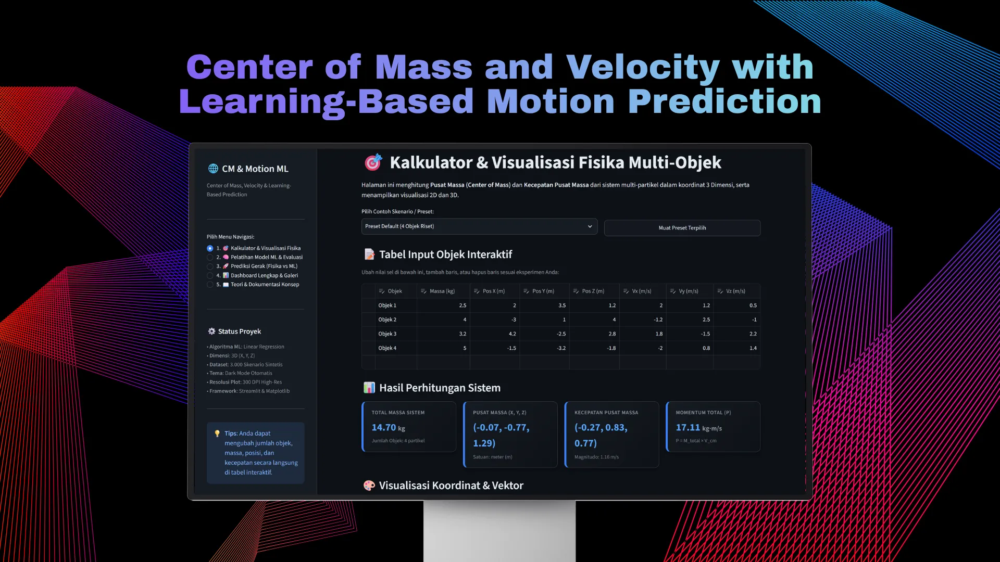


## Project Overview

**Center of Mass and Velocity with Learning-Based Motion Prediction** is a computational physics and supervised machine learning project that models multi-particle kinematics in three-dimensional space and predicts future center-of-mass coordinates from noisy measurement inputs. It combines analytical rigid-body mechanics—computing mass-weighted center-of-mass position, velocity, and total momentum—with a multi-target `LinearRegression` model trained on a 3,000-scenario synthetic physics simulation dataset. The repository provides an interactive CLI script (`program.py`), an educational Jupyter notebook (`program.ipynb`), a 300 DPI publication-grade figure exporter (`extract_visualizations.py`), and a multi-page dark-mode Streamlit studio (`streamlit/app.py`).

## Problem Statement & Objectives

In real-world physical tracking systems such as robotics, drone navigation, and particle telemetry, measured center-of-mass positions and displacement vectors are affected by sensor noise and measurement uncertainty. Rather than relying solely on ideal noise-free analytical formulas, this project investigates how a data-driven linear estimator learns the underlying constant-velocity kinematic law from perturbed observations and recovers accurate future coordinates.

- Compute exact 3D Center of Mass ($\vec{R}_{cm}$), Center of Mass Velocity ($\vec{V}_{cm}$), and Total Momentum ($\vec{P}_{total}$) for arbitrary multi-object systems with positive masses.
- Generate a reproducible 3,000-sample synthetic kinematic dataset (`dataset_center_of_mass_ml.csv`) incorporating zero-mean Gaussian measurement noise ($\sigma = 0.05\text{ m}$) on input observations.
- Train and evaluate a multi-target Scikit-Learn `LinearRegression` estimator to predict future 3D Center of Mass coordinates $(X_{cm}, Y_{cm}, Z_{cm})$ against analytical physics ground truth.
- Provide interactive 2D and 3D visual diagnostics, residual distribution analysis, learned weight-matrix inspection, and 300 DPI figure exports through CLI and Streamlit interfaces.

## Data & Input Sources

No external dataset download is required. The project uses a self-contained synthetic physics simulator (`buat_dataset_sintetis` in [program.py](program.py)) that generates 3,000 independent multi-particle motion scenarios and persists them to [dataset_center_of_mass_ml.csv](dataset_center_of_mass_ml.csv). Each record simulates 2 to 6 objects with randomized masses ($0.5\text{–}10.0\text{ kg}$), initial 3D positions ($-20.0\text{ to }20.0\text{ m}$), 3D velocities ($-5.0\text{ to }5.0\text{ m/s}$), and prediction time horizons ($0.1\text{–}5.0\text{ s}$).

| Attribute | Description |
| :--- | :--- |
| **Dataset / Input Source** | Synthetic Multi-Particle Kinematics Simulation (`dataset_center_of_mass_ml.csv`) |
| **Source** | Generated locally via `buat_dataset_sintetis()` in [program.py](program.py) and [program.ipynb](program.ipynb) |
| **Format** | CSV (`3,000` data rows + header, `14` columns) |
| **Samples / Records** | `3,000` simulated scenarios (`2,400` training / `600` test) |
| **Features / Input Shape** | `N x 6` continuous float64 features (`cm_x/y/z_awal_terukur`, `perpindahan_x/y/z_terukur`) |
| **Target / Label** | `N x 3` continuous float64 targets (`cm_x_masa_depan`, `cm_y_masa_depan`, `cm_z_masa_depan`) |

## Data Preprocessing & Feature Engineering

To emulate real-world sensor uncertainty while preserving clean analytical ground truth for supervised regression, the data generation and preparation pipeline isolates measured inputs from noiseless target coordinates and enforces a deterministic train-test boundary.

| Transformation | Input Variables | Output Variables | Purpose |
| :--- | :--- | :--- | :--- |
| **Mass-Weighted Aggregation** | Object masses $m_i$, positions $\vec{r}_i$, velocities $\vec{v}_i$ | Initial $\vec{R}_{cm,0}$, velocity $\vec{V}_{cm}$ | Reduces multi-object state into single 3D system vectors |
| **Kinematic Integration** | $\vec{R}_{cm,0}$, $\vec{V}_{cm}$, horizon $t$ | True displacement $\Delta \vec{R}$, future $\vec{R}_{cm}(t)$ | Computes noiseless ground-truth targets |
| **Gaussian Noise Injection** | True $\vec{R}_{cm,0}$ and $\Delta \vec{R}$ | 6 noisy features ($\sigma = 0.05\text{ m}$) | Simulates measurement uncertainty without corrupting targets |
| **Holdout Splitting** | Full 3,000-row feature/target matrices | 80% Train (`2,400`), 20% Test (`600`) | Evaluates generalization on unseen scenarios (`random_state=42`) |

1. Sample object count $N \in \{2, 3, 4, 5, 6\}$, masses, initial 3D coordinates, 3D velocities, and time $t$ using `np.random.default_rng(42)`.
2. Calculate exact initial center of mass and center-of-mass velocity via `hitung_pusat_massa` and `hitung_kecepatan_pusat_massa`.
3. Compute analytical displacement $\Delta \vec{R} = \vec{V}_{cm} \cdot t$ and ground-truth future position $\vec{R}_{cm}(t) = \vec{R}_{cm,0} + \Delta \vec{R}$.
4. Perturb only the 6 model input columns (`cm_*_awal_terukur` and `perpindahan_*_terukur`) with independent $\mathcal{N}(0, 0.05^2)$ noise.
5. Partition `X` and `y` via `train_test_split(X, y, test_size=0.2, random_state=42)` prior to model fitting.

## Tech Stack

| Category | Technology | Purpose |
| :--- | :--- | :--- |
| **Programming Language** | Python | Core physics engine, dataset simulation, ML training, and UI runtime |
| **Numerical Computing** | NumPy | Vectorized 3D coordinate math, random number generation, and error norms |
| **Data Manipulation** | Pandas | Tabular dataset construction, CSV persistence, and interactive table editing |
| **Machine Learning** | Scikit-Learn | `LinearRegression` multi-target estimator, data splitting, and regression metrics |
| **Data Visualization** | Matplotlib | 2D/3D scatter plots, quiver velocity diagrams, residual histograms, and 300 DPI exports |
| **Interactive Web UI** | Streamlit | 5-page dark-mode analytical dashboard, parameter sliders, and asset download studio |
| **Notebook Environment** | Jupyter Notebook | Step-by-step reproducible walkthrough and Colab-compatible experimentation |

## Machine Learning Approach

The modeling task is formulated as **Supervised Learning** using multi-target continuous regression. Given six noisy kinematic measurements representing the initial center-of-mass position and measured displacement vector, the model directly estimates the noise-free 3D future center-of-mass coordinates without requiring explicit hardcoding of the analytical addition rule during inference.

| Attribute | Details |
| :--- | :--- |
| **Learning Paradigm** | Supervised Learning |
| **Problem Domain** | Computational Kinematics & Multi-Particle Mechanics |
| **ML Task** | Multi-Target Continuous Regression (3D Coordinate Prediction) |
| **Model Input** | 6D vector: `[cm_x_awal_terukur, cm_y_awal_terukur, cm_z_awal_terukur, perpindahan_x_terukur, perpindahan_y_terukur, perpindahan_z_terukur]` |
| **Model Target / Output** | 3D vector: `[cm_x_masa_depan, cm_y_masa_depan, cm_z_masa_depan]` |
| **Approach** | Ordinary Least Squares linear mapping trained on synthetic perturbed kinematics, benchmarked against exact analytical physics $\vec{R}_{cm}(t) = \vec{R}_{cm}(0) + \vec{V}_{cm}t$ |

## Model Overview

This project trains a single primary model from scratch using Scikit-Learn's `LinearRegression` estimator; no pretrained external weights or checkpoints are loaded. Because the underlying constant-velocity translation law is linear across orthogonal spatial axes, Ordinary Least Squares naturally learns a $3 \times 6$ weight matrix $\mathbf{W}$ and 3D bias vector $\vec{b}$ that recover the identity mapping per axis while attenuating zero-mean measurement noise.

| Attribute | Details |
| :--- | :--- |
| **Model Name** | Multi-Target Ordinary Least Squares Regressor |
| **Algorithm / Architecture** | `sklearn.linear_model.LinearRegression` ($\hat{\vec{Y}} = \mathbf{W}\vec{X} + \vec{b}$) |
| **Model Type** | Linear Regression (Multi-Output) |
| **Framework** | Scikit-Learn |
| **Input Dimensions** | 6 continuous features (meters) |
| **Output Dimensions** | 3 continuous target coordinates (meters) |
| **Pretrained Status** | Trained from scratch in-memory on project dataset (`2,400` training samples) |

## ML Workflow

1. **Physics Computation & Scenario Setup**: Compute exact 3D center of mass and center-of-mass velocity for multi-object particle systems via `hitung_pusat_massa` and `hitung_kecepatan_pusat_massa` in [program.py](program.py).
2. **Synthetic Dataset Generation**: Simulate 3,000 randomized multi-particle motion scenarios with Gaussian input noise (`noise_std=0.05`, `random_state=42`) and export to [dataset_center_of_mass_ml.csv](dataset_center_of_mass_ml.csv).
3. **Train-Test Partitioning**: Split the 6-feature matrix and 3-target matrix into 80% training (`2,400` rows) and 20% testing (`600` rows) using `train_test_split` in [program.py](program.py), [program.ipynb](program.ipynb), and [streamlit/app.py](streamlit/app.py).
4. **Model Fitting**: Fit `LinearRegression()` on the training split to learn the $3 \times 6$ coefficient matrix $\mathbf{W}$ and intercept vector $\vec{b}$.
5. **Empirical Evaluation**: Compute overall and per-axis (X, Y, Z) MAE, RMSE, and $R^2$ on the held-out 600 test scenarios, alongside residual error distributions.
6. **Physics vs. ML Inference & Visualization**: Compare live 3D trajectory predictions from the fitted ML model against analytical physics formulas and export high-resolution 300 DPI plots via [extract_visualizations.py](extract_visualizations.py) or explore interactively in [streamlit/app.py](streamlit/app.py).

## ML Pipeline Architecture

The end-to-end architecture connects the multi-particle physics simulator, noisy feature generation, train-test split, linear regression training, quantitative evaluation, and dual consumption paths (300 DPI static figure exporter and interactive 5-page Streamlit studio).

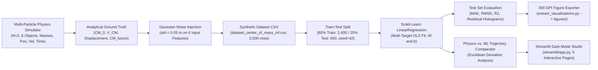

## Model Training & Configuration

Model training is executed from scratch using Scikit-Learn's closed-form Ordinary Least Squares solver (`LinearRegression()`) with default solver settings (`fit_intercept=True`). In the interactive Streamlit studio ([streamlit/app.py](streamlit/app.py)), users can also dynamically vary the synthetic sample count (`500`–`10,000`), noise standard deviation (`0.00`–`0.30 m`), test split ratio (`0.10`–`0.40`), and random seed, with results cached via `@st.cache_resource`.

| Parameter / Setting | Verified Value | Source File |
| :--- | :--- | :--- |
| **Dataset Samples** | `3,000` scenarios (`2,400` train / `600` test) | [program.py](program.py), [dataset_center_of_mass_ml.csv](dataset_center_of_mass_ml.csv) |
| **Test Split Ratio** | `0.2` (20% holdout) | [program.py](program.py), [streamlit/app.py](streamlit/app.py) |
| **Random Seed** | `42` (dataset RNG & split) | [program.py](program.py), [program.ipynb](program.ipynb) |
| **Input Noise Std Dev** | `0.05` m (Gaussian $\mathcal{N}(0, 0.05^2)$) | [program.py](program.py) |
| **Estimator** | `sklearn.linear_model.LinearRegression()` | [program.py](program.py), [extract_visualizations.py](extract_visualizations.py) |
| **Loss / Objective** | Residual Sum of Squares (OLS / L2) | Scikit-Learn `LinearRegression` |
| **Intercept Fitting** | `fit_intercept=True` (default) | [program.py](program.py) |

```python
X = dataset[FEATURE_COLUMNS]
y = dataset[TARGET_COLUMNS]
X_train, X_test, y_train, y_test = train_test_split(
    X, y, test_size=0.2, random_state=42
)

model = LinearRegression()
model.fit(X_train, y_train)
y_prediksi = model.predict(X_test)
```

## Model Evaluation & Results

Evaluated on the held-out 600-sample test set (`dataset_center_of_mass_ml.csv`, `test_size=0.2`, `random_state=42`), the `LinearRegression` model achieves near-unity variance explanation and sub-decimeter prediction error consistent with the $\sigma = 0.05\text{ m}$ Gaussian noise injected independently on both initial center-of-mass and displacement inputs (theoretical combined axis noise standard deviation $\sqrt{0.05^2 + 0.05^2} \approx 0.0707\text{ m}$).

| Evaluation Scope | MAE (m) | RMSE (m) | $R^2$ Score | Notes |
| :--- | :--- | :--- | :--- | :--- |
| **Overall Test Set (600 samples)** | `0.058072` | `0.072610` | `0.999927` | Combined across X, Y, Z target coordinates |
| **X-Axis (`cm_x_masa_depan`)** | `0.056738` | `0.070014` | `0.999932` | Target range `-34.87 m` to `33.77 m` |
| **Y-Axis (`cm_y_masa_depan`)** | `0.059036` | `0.074337` | `0.999922` | Target range `-37.24 m` to `30.43 m` |
| **Z-Axis (`cm_z_masa_depan`)** | `0.058441` | `0.073407` | `0.999927` | Target range `-31.46 m` to `34.29 m` |

- **Learned Weight Reconstruction**: The fitted $3 \times 6$ coefficient matrix yields diagonal identity weights near `1.0` (`[1.000021, 0.999844, 0.999898]` for initial CM and `[1.000146, 0.999592, 0.999325]` for displacement), orthogonal cross-axis weights near `0.0`, and intercepts `[0.001471, 0.002426, 0.001115]`.
- **Zero-Centered Residuals**: Test residuals exhibit near-zero empirical means across X (`-0.0019 m`), Y (`0.0052 m`), and Z (`-0.0002 m`), confirming unbiased linear estimation.
- **Physics vs. ML Trajectory Benchmark**: On the default 4-object preset at $t = 2.0\text{ s}$, analytical physics predicts `(-0.622, 0.895, 2.826) m` and Linear Regression predicts `(-0.621, 0.895, 2.826) m`, yielding a Euclidean deviation of `0.00048 m`.
- **Known Limitations**: Training and evaluation rely entirely on synthetic constant-velocity kinematics with isotropic Gaussian noise; external forces, acceleration, non-linear dynamics, and real hardware sensor drift are not modeled.

## Results Visualization & Preview

### 1. Interactive Multi-Object Physics Calculator & System KPIs
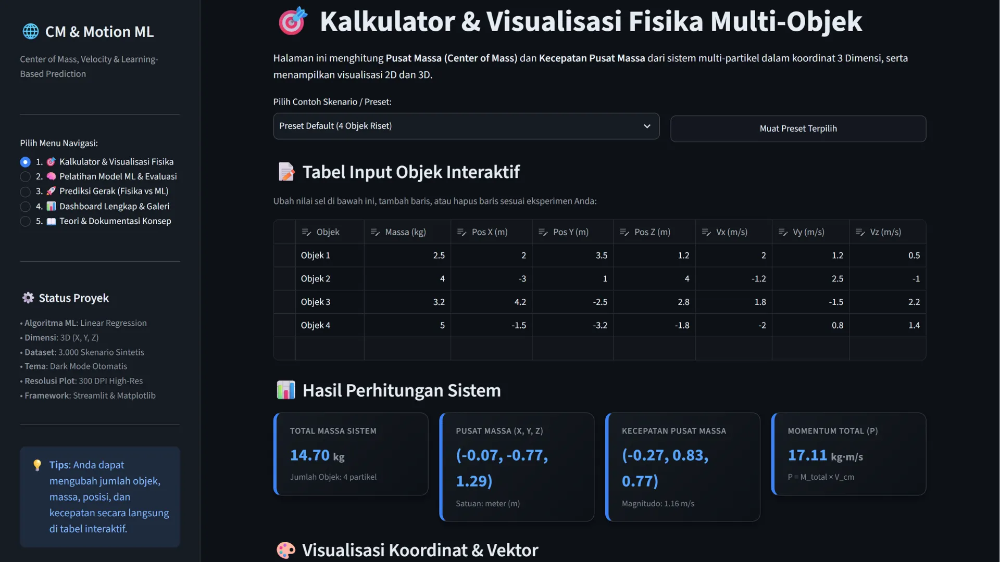
Page 1 of the Streamlit Dark-Mode Studio displays an editable multi-object data grid alongside real-time system telemetry cards for the default 4-particle preset: total mass (`14.70 kg`), center of mass (`(-0.07, -0.77, 1.29) m`), center-of-mass velocity (`(-0.27, 0.83, 0.77) m/s`), and total momentum (`17.11 kg·m/s`).

### 2. 2D Center of Mass Spatial Distribution (X-Y Plane)
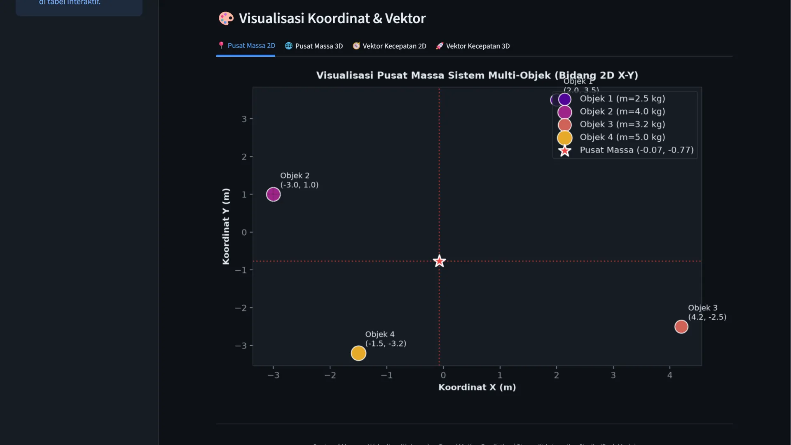
The interactive 2D scatter plot visualizes the four mass-weighted particles across the X-Y coordinate plane and marks the computed center of mass at `(-0.07, -0.77) m` with orthogonal red reference crosshairs.

### 3. 2D Velocity Vector Quiver Diagram
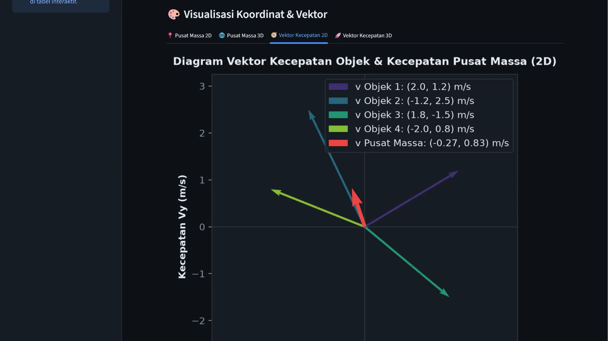
A 2D quiver diagram plots each particle's individual velocity vector alongside the resulting mass-weighted center-of-mass velocity vector (`(-0.27, 0.83) m/s`), illustrating vector cancellation and directional dominance.

### 4. ML Training Configuration & Evaluation Metrics Summary
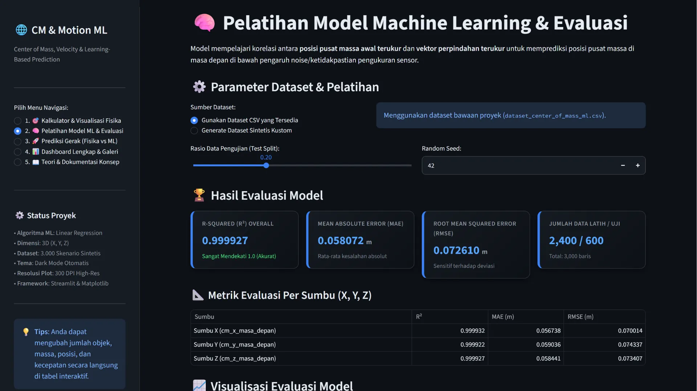
Page 2 of the Streamlit studio reports holdout test performance (`2,400` training / `600` testing samples) for `dataset_center_of_mass_ml.csv`, highlighting an overall $R^2$ of `0.999927`, MAE of `0.058072 m`, RMSE of `0.072610 m`, and the per-axis metric breakdown table.

### 5. Actual vs. Predicted Regression Plots (X, Y, Z Axes)
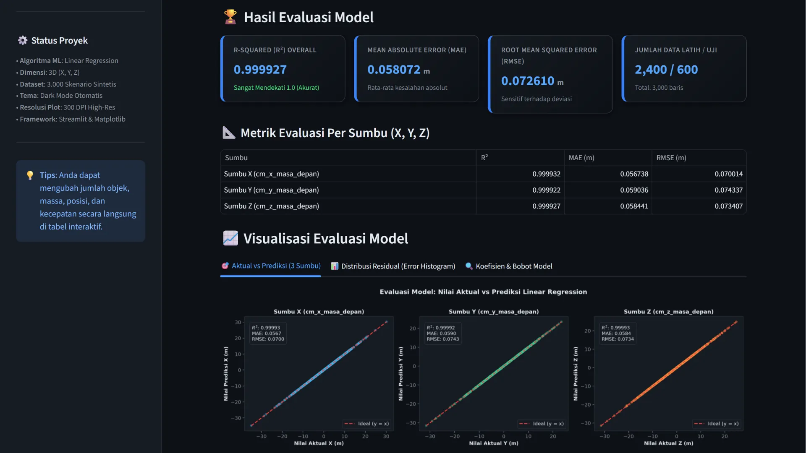
Three dark-mode scatter plots compare ground-truth test positions against `LinearRegression` predictions across X, Y, and Z axes, showing tight alignment along the ideal $y = x$ dashed diagonal with per-axis $R^2 \ge 0.99992$.

### 6. Residual Error Distribution Histograms
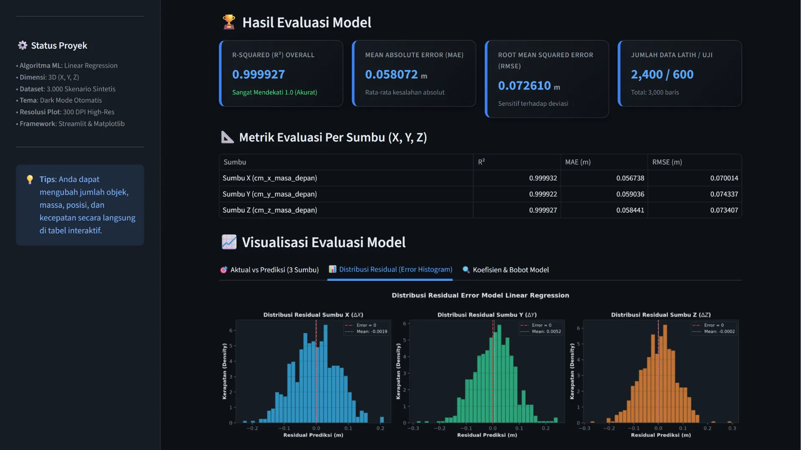
Normalized residual density histograms for $\Delta X$, $\Delta Y$, and $\Delta Z$ show symmetric bell-shaped error distributions centered around zero (`mean = -0.0019 m`, `0.0052 m`, and `-0.0002 m`), matching the injected Gaussian measurement noise profile.

### 7. Learned Weight Matrix & Bias Vector Inspection
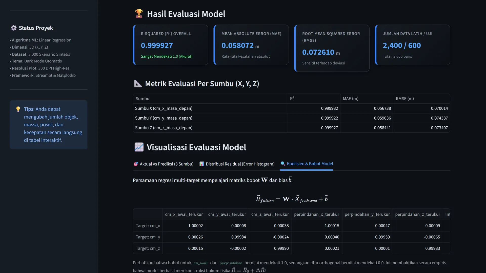
The coefficient inspection tab presents the learned $3 \times 6$ weight matrix $\mathbf{W}$ and bias vector $\vec{b}$, demonstrating empirically that weights for matched spatial components converge to `~1.0` (`0.99933`–`1.00015`) while orthogonal cross-axis coefficients remain near `0.0`.

### 8. Physics vs. Machine Learning Future Position Comparator
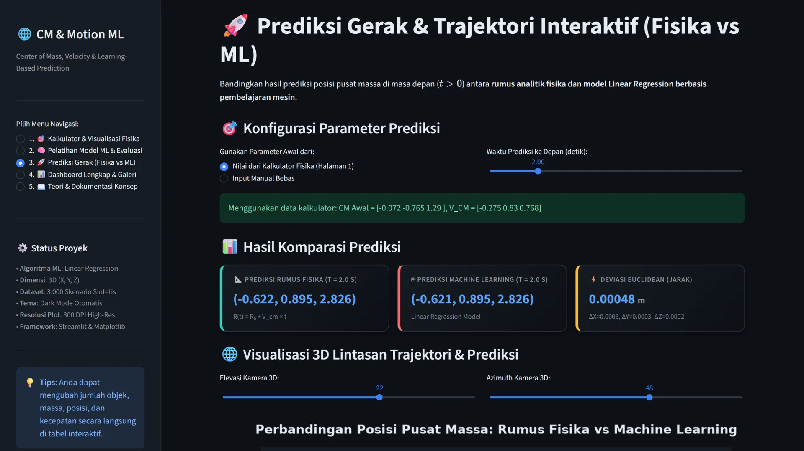
Page 3 compares analytical constant-velocity motion prediction (`(-0.622, 0.895, 2.826) m`) against the trained Linear Regression prediction (`(-0.621, 0.895, 2.826) m`) at $t = 2.0\text{ s}$, recording a Euclidean deviation of `0.00048 m`.

### 9. 3D Trajectory Comparison Plot (Physics vs. ML)
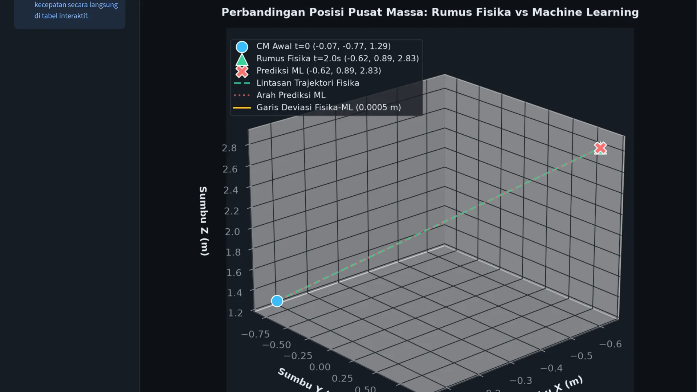
An interactive 3D trajectory plot traces motion from the initial center of mass at $t = 0$ to both the analytical physics endpoint and ML-predicted endpoint at $t = 2.0\text{ s}$, showing near-identical paths with a `0.0005 m` deviation.

### 10. Unified 4-in-1 Summary Dashboard View
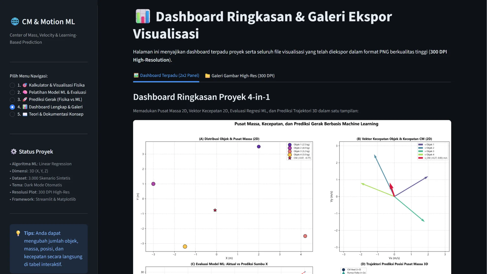
Page 4 embeds the 4-panel composite project dashboard combining 2D center-of-mass coordinates, 2D velocity vectors, X-axis regression parity, and 3D future trajectory prediction with direct 300 DPI PNG download support.

### 11. Mathematical Formulations & Theory Documentation
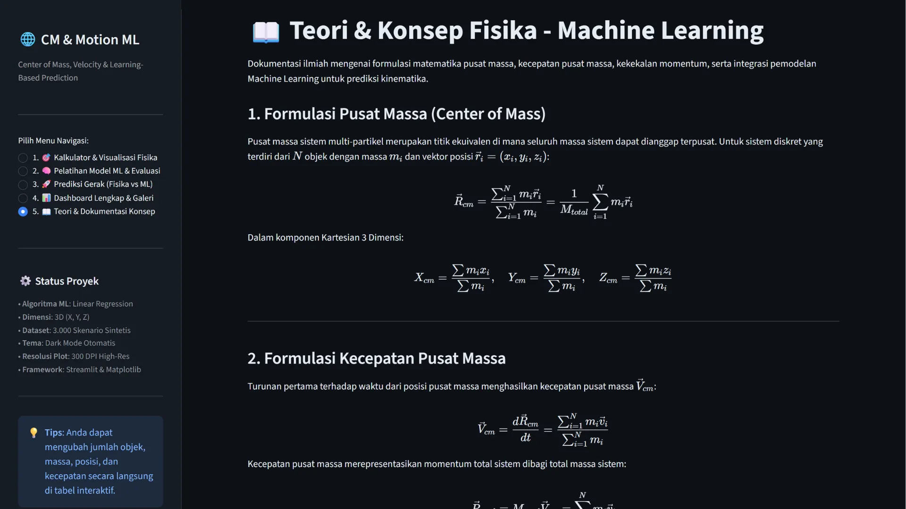
Page 5 documents the LaTeX mathematical foundations of discrete multi-particle center of mass, center-of-mass velocity, linear momentum conservation, and noisy-feature regression formulation.

### 12. High-Resolution 300 DPI Export: 2D Physics & Velocity Plots
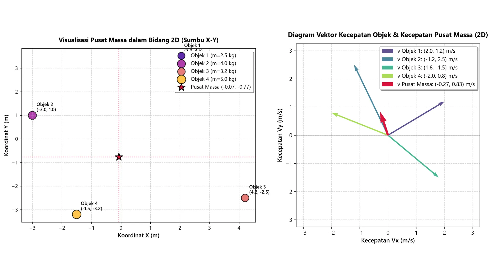
Publication-ready 300 DPI exports (`01_pusat_massa_2d.png` and `03_kecepatan_pusat_massa_2d.png`) render clean white-background 2D position and velocity quiver charts with mass-scaled markers and full coordinate annotations.

### 13. High-Resolution 300 DPI Export: 3D Physics & Velocity Plots
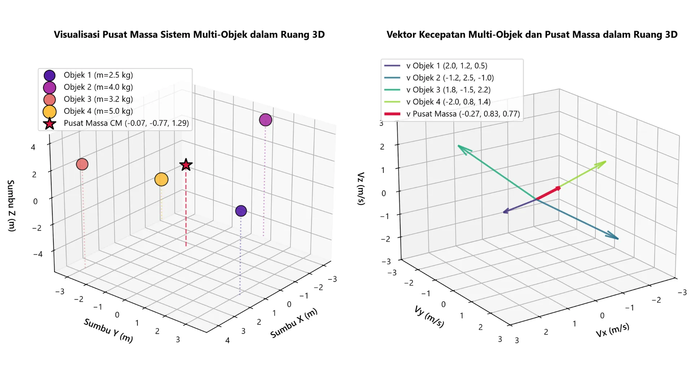
Publication-ready 300 DPI 3D exports (`02_pusat_massa_3d.png` and `04_kecepatan_pusat_massa_3d.png`) present spatial particle positions with vertical projection drop lines and 3D velocity vectors across X, Y, and Z axes.

### 14. High-Resolution 300 DPI Export: 6-Panel ML Evaluation & Residuals
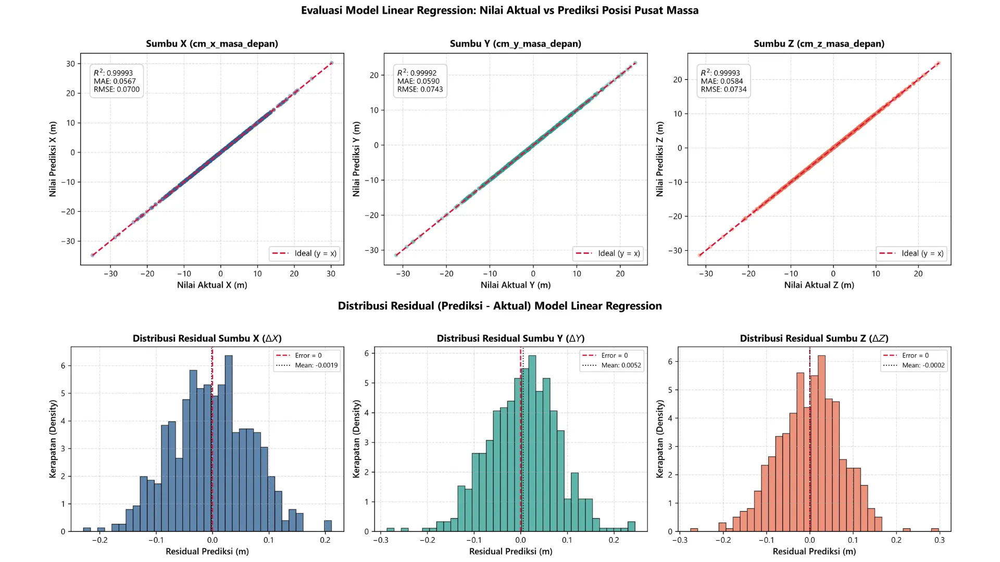
Combined 300 DPI diagnostic figures (`05_evaluasi_linear_regression.png` and `06_distribusi_residual_error.png`) pair per-axis Actual vs. Predicted scatter plots (top row) with zero-centered residual density histograms (bottom row).

### 15. High-Resolution 300 DPI Export: 3D Motion Prediction Comparison
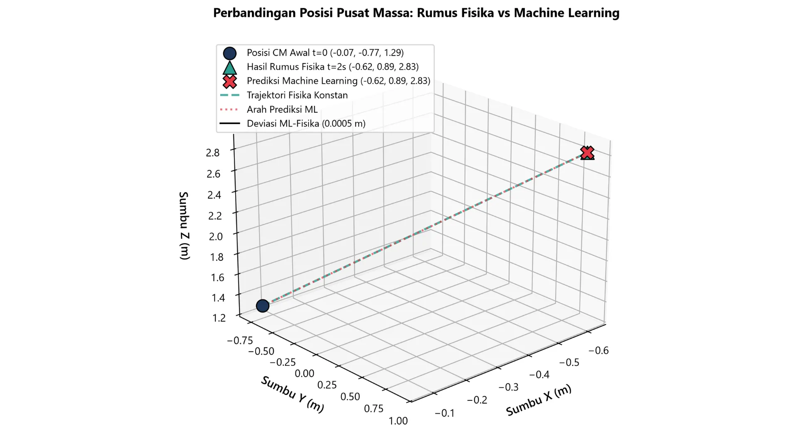
The exported 300 DPI 3D trajectory comparison (`07_perbandingan_prediksi_posisi_3d.png`) highlights complete directional overlap between the analytical constant-velocity path and the Linear Regression prediction at $t = 2.0\text{ s}$ (`0.0005 m` deviation).

## Prerequisites

- **Operating System**: Windows, macOS, or Linux (CPU execution only; no GPU or CUDA required)
- **Python Runtime**: Python 3.8 or newer
- **Core Libraries** (for CLI and notebook execution): `numpy`, `pandas`, `matplotlib`, `scikit-learn`
- **Web Studio Dependency** (for the interactive UI): `streamlit`
- **Notebook Runner** (optional, for `program.ipynb`): `jupyter` or Google Colab

## Installation & Setup

1. Clone the repository and navigate to the project directory:

   ```bash
   git clone https://github.com/weztcy/Center-of-Mass-and-Velocity-with-Learning-Based-Motion-Prediction.git
   cd "Center of Mass and Velocity with Learning-Based Motion Prediction"
   ```

2. Create and activate a virtual environment:

   ```bash
   python -m venv .venv
   # Windows (PowerShell)
   .venv\Scripts\Activate.ps1
   # macOS / Linux
   source .venv/bin/activate
   ```

3. Install the required Python dependencies:

   ```bash
   pip install numpy pandas matplotlib scikit-learn streamlit
   ```

## Usage & Execution

The project supports interactive CLI execution, batch 300 DPI figure export, interactive web exploration via Streamlit, and step-by-step notebook execution.

1. **Run the Interactive CLI Menu** (physics calculator, ML training/evaluation, and custom prediction):

   ```bash
   python program.py
   ```

2. **Export All 300 DPI High-Resolution PNG Visualizations**:

   ```bash
   python program.py --export
   # or directly:
   python extract_visualizations.py
   ```

3. **Launch the Interactive Streamlit Dark-Mode Studio**:

   ```bash
   streamlit run streamlit/app.py
   ```

4. **Run the Jupyter Notebook**:
   Open [program.ipynb](program.ipynb) in JupyterLab, VS Code, or Google Colab and execute cells sequentially from Section 1 to Section 7.

## Reproducibility & Execution

Because the dataset is generated deterministically in Python and the `LinearRegression` estimator uses a closed-form Ordinary Least Squares solution, all metrics and plots are directly reproducible across CPU environments.

1. Keep the repository's [dataset_center_of_mass_ml.csv](dataset_center_of_mass_ml.csv) in the project root, or regenerate it identically using `buat_dataset_sintetis(jumlah_sampel=3000, noise_std=0.05, random_state=42)`.
2. Preserve `test_size=0.2` and `random_state=42` in `train_test_split` when training `LinearRegression()`.
3. Execute the batch verification script ([extract_visualizations.py](extract_visualizations.py)) to reproduce the exact test metrics (`MAE = 0.058072 m`, `RMSE = 0.072610 m`, `R^2 = 0.999927`) and all 8 300 DPI PNG figures:

   ```bash
   python extract_visualizations.py
   ```

4. **Note on Output Directories**: Running `extract_visualizations.py` writes outputs to `visualizations/`, whereas pre-exported assets in the repository are stored in `figures/`. Minor floating-point rounding differences in the 6th decimal place may occur across BLAS/LAPACK implementations.

## Contributing

Contributions are welcome to extend the physics simulator (such as adding external forces, acceleration, or non-linear dynamics) or benchmark additional regression models. Please follow this standard workflow:

1. Fork the repository.
2. Create a branch for the change.
3. Make the changes.
4. Run relevant checks or tests when available.
5. Commit and push the branch.
6. Open a pull request with a clear explanation.

## License

This project is licensed under the MIT License.
See the [LICENSE](LICENSE) file for details.

## Author & Contact

**Yohanes Dimas Pratama**

- GitHub: [github.com/weztcy](https://github.com/weztcy)
- Portfolio: [yohanesdimas.com](https://yohanesdimas.com)
- LinkedIn: [linkedin.com/in/yohanes-dimas](https://www.linkedin.com/in/yohanes-dimas)
